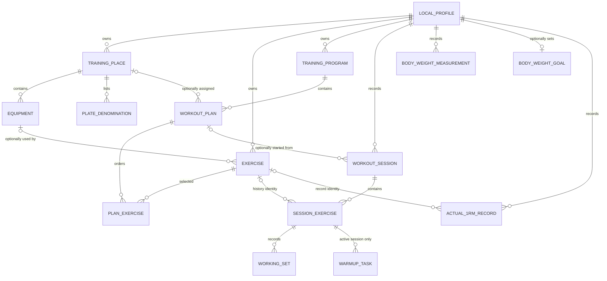

# Phase I — Conceptual Domain Model

**Status:** Working design for review. This describes product concepts and relationships, not a SQLite schema or an implementation. The [equipment decisions](equipment-decisions.md) record agreed behavior; open decisions below are not requirements.

The model-review decisions in that document supersede earlier details here, including requiring a copy when an exercise is added twice to one unit and the choice to preserve or delete history when deleting an exercise. Phase I sessions start from a plan.

## Relationship overview

These links express conceptual relationships. Historical records must survive removal of a plan, place or equipment, and exercise history is retained or removed according to the user's deletion choice. A session starts from a plan, but its source link may no longer exist after plan removal. Place and equipment are optional. A plan has at most one place, fixed for a session before it begins.

## Concepts

| Concept | Responsibility and relationships |
|---|---|
| Local profile | The trainee's local ownership context and settings, later linkable to an account. Phase I needs no account. |
| Training place | A private home or gym place with name and optional address/description; owns an equipment inventory and plate denominations. Users can have multiple places. |
| Equipment | A distinct bar, machine, dumbbell or kettlebell configuration at a place. It has a name and optional description and photo; type-specific information describes available settings. Photo storage remains open. |
| Plate denomination | An available plate weight in a place's shared inventory. Quantities are not stored; calculations assume sufficient plates. Compatibility and adjustable dumbbell details remain open. |
| Exercise | A user's reusable exercise with its own identity, name, primary muscle group, optional secondary groups, technical note, personal equipment settings and optional equipment reference. Its recording meaning distinguishes weighted, repetition-only and assisted exercises; the precise representation remains open. Working-set configuration, warm-up configuration and progression choice are shared when this exercise is reused. A separate copy has independent settings and history. |
| Training program | A named collection of workout plans; the user may choose a main program. |
| Workout plan / unit | An ordered set of chosen exercises, optionally assigned to a weekday and one place. A plan for another place is a separate unit. |
| Plan exercise | The association placing an exercise in a workout plan and defining its order; its identity is distinct from the shared exercise. Any additional plan-specific settings are still open. |
| Workout session | A performed or active workout started from a plan. It retains information needed to understand what happened even if its source changes or is removed. |
| Session exercise | The occurrence of an exercise within a session, with performed equipment/place information and notes as applicable. History preserves the equipment and place names used at the time; renaming a shared exercise updates its displayed historical name. |
| Working set | Recorded repetitions, optional RIR and, where applicable, weight or assistance with an explicit meaning, associated with its session exercise and ordered for per-set progression. Repetition-only entries have no required load; absence is distinct from zero. |
| Warm-up task | A configured warm-up shown during an active session, including suggested or edited values and completion state. It can be unchecked and must survive interruption. It is not included in completed workout history, working-set progression or statistics. Its lifecycle and exact representation require design. |
| Body-weight measurement | A dated user-entered measurement, at most one per profile and calendar date. Missing days remain missing. |
| Body-weight goal | An optional target for the profile. Trend, moving average and forecast are derived from measurements, not assumed to be stored as measurements. |
| Actual 1RM record | A manually entered exercise, date and weight, independent of normal sets. It follows the user's choice to preserve or delete exercise history; estimated 1RM is a separately derived value. |

Equipment subtypes have different meanings: a stack machine exposes labeled settings, a plate-loaded machine describes its loading arrangement, and a bar has a mass. A labeled machine weight or plate load must not be presented as measured resistance. Fixed dumbbells and kettlebells have weights and quantities; adjustable equipment needs additional design. Available plate denominations are not quantities.

## Worked examples

### Shared exercise in two units

The user selects one exercise, **Bench press**, in both Monday and Friday units. Both references point to the same exercise: its settings, history and progression are shared. The units remain independently ordered. Changing the shared exercise's settings affects both units; already performed sessions preserve recorded set values.

To use a different repetition range with independent history, the user creates a copy. The copy may retain the same name and equipment, but has a new identity, its own settings and empty history. Different machines are represented by independent exercises rather than assuming their loads are equivalent.

### Place, equipment and a recorded set

A unit is assigned to a private gym with a 20 kg bar and listed 20 kg, 10 kg and 1.25 kg plates. An exercise uses that bar. The user records 60 kg total: the example arrangement is 20 kg per side. A possible next symmetric total is 62.5 kg using an additional 1.25 kg per side, assuming enough plates. In one-side entry mode the same values are 20 kg and 21.25 kg; the meaning must remain explicit. A later change to the inventory does not change the recorded result.

### Active workout and completed history

A session starts from a plan and contains session-specific exercise occurrences. The first working set automatically marks remaining warm-up tasks complete; their visibility depends on the workout view and they can be unchecked. If the app closes, the active state can be resumed. When the workout is completed, working-set results remain available in history; warm-up tasks are not part of that history. Deleting the plan later must not delete those results.

### Statistics and different exercise meanings

Push-ups record repetitions without a weight and can yield the best set and total repetitions for a workout. Assisted pull-ups record assistance separately from repetitions: less assistance can be progression, and the assistance value is not a lifted weight. A separately created weighted pull-up has its own identity and history. Changing an exercise's primary muscle group moves its retained history to the current group in group summaries. Seven measurements across 14 days may satisfy the forecast's measurement-frequency rule, but trend eligibility and other forecast conditions also apply; missing calendar days are never fabricated.

## Cross-cutting design constraints

- Local data works offline. Domain objects should not depend on SQLite representation. Plan a migration strategy before schema implementation.
- Use stable client-generated UUIDs and timestamps and preserve profile ownership. Keep synchronization metadata separate from domain data; design deletion to support later synchronization. The detailed protocol is a later-phase decision.
- Separate current equipment details and exercise settings from performed-session information so later changes do not rewrite historical values. Preserve shared exercise renaming behavior while keeping readable history after exercise removal; the exact mechanism remains open.
- Include private places, equipment, and user data in versioned JSON backup and restoration. Photo storage and how image bytes are included and recovered remain open design decisions.
- Future coach access to equipment follows the accepted relationship decision; other trainee data remains subject to its own sharing rules. Model ownership now without implementing cloud sharing in Phase I.

## Model validation: changes and deletion

These examples check agreed outcomes; persistence and atomic operations are proposals to be designed, not completed implementation.

| Scenario | Expected behavior | Model consequence |
|---|---|---|
| A shared exercise appears in Monday and Friday units; the user saves a change to its settings. | Both units use the changed settings; warn about both before saving. Past recorded results remain unchanged. | Units reference one exercise identity; active and performed sessions hold their own relevant state. |
| The user removes that exercise from Monday only. | Friday, the exercise collection and history remain unchanged. | Remove only Monday's association. A second occurrence in one unit requires an independent copy. |
| The user copies the exercise or changes it to a different machine via an independent version. | The original remains; the new exercise has copied settings, independent history and selected machine. | Assign a new exercise identity; copying with the same machine reuses the equipment and photo. |
| The user deletes an exercise from the collection and chooses to keep history. | It disappears from all units; previous results stay readable, using its last name. Other exercises are unaffected. | Retain enough historical identity and display information without retaining it as a selectable active exercise. |
| The user deletes an exercise and chooses to delete its history. | After explicit confirmation, its results disappear from completed workouts; other exercises remain. If a session becomes empty, ask whether to remove it or retain it with its date and note. | Remove selected results without automatically deleting unrelated sessions; implement the user's choice for empty sessions. |
| A machine or gym is edited or removed after a workout. | Future use reflects current equipment or indicates missing equipment; recorded place/equipment names and values stay unchanged. Deleting a gym removes its assignment from affected units after confirmation. | Current references are separate from recorded information. Exercise identity and its displayed name follow their own rules. |
| Equipment data changes during an active workout. | The active session keeps the equipment data from its start; changes apply to later sessions. Manual weight entry still works. Deletion of an exercise, equipment item or plan used by the active session is blocked until the workout is finished or cancelled. | Capture sufficient session state to resume without reading changed inventory as the original; enforce the deletion restriction. Exact capture requires design. |
| The user renames an existing shared exercise. | Its name is updated in units and displayed history; recorded sets and historical equipment names do not change. | Resolve the display name through retained exercise identity while active; preserve the last name if the user deletes the exercise and keeps history. |
| The user corrects or removes the latest recorded result. | Future suggestions use the corrected result or previous applicable result; no previous result means manual entry. | Progression reads current valid history, not a permanently stored old suggestion. |
| The app closes mid-session after warm-ups are checked. | The user resumes with completion states and can undo them; after finishing, warm-ups are not stored in completed history. | Persist transient session state for recovery, then exclude it from completed history; cleanup mechanism is open. |

## Validation findings

- **Consistent:** shared exercise identity, independent copies, session snapshots and independent plan ordering can represent the agreed behaviors above.
- **Needs further design:** the precise state copied into an active session and how to retain historical identity without a selectable exercise. These are not yet implementation decisions.
- **Not yet verified:** actual SQLite constraints, atomic deletion, backup/restore, synchronization and UI behavior; this document is a conceptual check only.

## Open questions for review

1. Which settings, if any, belong to a plan occurrence rather than the shared exercise? How do saved session changes update a shared exercise used by several units?
2. How should the app identify and communicate which active-session dependencies block deletion?
3. How should retained identity and display information preserve history when the user chooses to keep it after exercise deletion, while supporting shared exercise renaming?
4. When a plan has no place, how is the no-place option presented before the session?
5. How are photos stored and included in backup, and which fields are optional? How are equipment compatibility and adjustable dumbbells represented?
6. How are active warm-up tasks cleared on completion while retaining interruption recovery and undo during a session?
7. How are weight units and precision represented without rounding errors? How does the app present incomplete equipment data and switching progression methods?

The detailed formulas, screens, persistence schema and migration design are subsequent work; this sketch alone does not complete the foundations stage.
